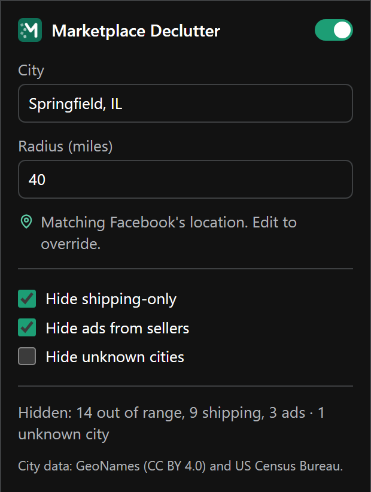
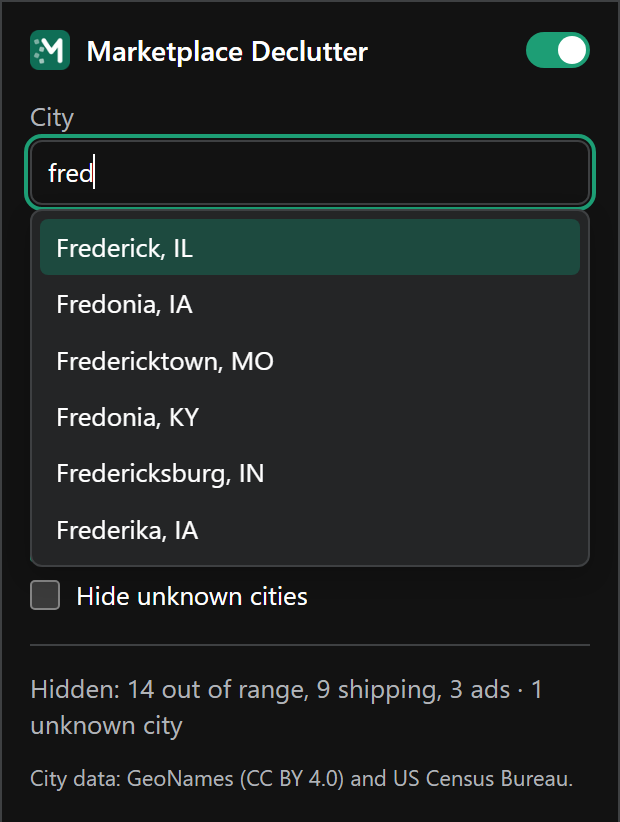

<p align="center">
  
</p>

# Marketplace Declutter

A Chrome and Edge extension that makes Facebook Marketplace show what you asked
for: listings near you. Marketplace pads the feed with shipped items, listings
outside your radius, and seller ads. Marketplace Declutter hides all three.

<p align="center">
  
  &nbsp;
  
</p>

## What it hides

| Listing | Hidden when |
| --- | --- |
| Out of range | Its city is farther from your centre than your radius |
| Shipping-only | It is marked "Ships to you" (can be turned off) |
| Seller ad | It is marked "Ad from seller" (can be turned off) |

A listing is only hidden when the extension is sure. If a city is not
recognised, the listing stays visible and is counted as "unknown city".

## Install

The extension is not on the Chrome Web Store yet, so load it from source:

1. Download or clone this repository.
2. Open `chrome://extensions` (or `edge://extensions`).
3. Turn on **Developer mode**.
4. Click **Load unpacked** and choose the repository folder.
5. Open or refresh Facebook Marketplace.

## Using it

By default there is nothing to set up. The extension reads the location and
radius from Marketplace's own location filter and applies them properly.

To use a different location, click the toolbar icon and start typing in the
**City** field. Matching cities appear as you type, nearest first; pick one
with the mouse, Enter, or Tab. Your choice stays in effect until you click
**Use Facebook's location**.

The popup also shows how many listings were hidden on the current page and why.

## Privacy

- Everything runs in your browser. The extension makes no network requests
  other than loading its own bundled city table.
- It reads the Marketplace page only to find listing cards and the location
  filter. Nothing about you or your browsing leaves your machine.
- Settings are saved with Chrome's extension storage.

## Limitations

- United States only.
- Distance is measured city to city, not from the exact listing address.
- It hides listings after Facebook has loaded them; it does not change what
  Facebook sends. When most of a batch is hidden, the page loads more for you.
- Facebook changes its pages often, which can break detection until the
  extension is updated.

## How it works

| File | Role |
| --- | --- |
| `manifest.json` | Manifest V3; no background worker |
| `content.js` | Finds listing cards, hides them, watches for new ones |
| `lib/geo.js` | Pure logic: parsing, city lookup, distance, suggestions |
| `popup.html`, `popup.js` | Settings and hidden counts |
| `data/places.json` | About 50,000 US cities with coordinates |
| `scripts/build-places.mjs` | Regenerates the city table (development only) |

There is no build step and no runtime dependency.

## Development

Requires Node 20 or later, used only for tests and for regenerating the city table.

```
npm test
```

To regenerate `data/places.json`, see [NOTICE.md](NOTICE.md) for the source
files and the command.

After changing code, click the reload icon for the extension at
`chrome://extensions`, then refresh the Marketplace tab.

## Data sources

City data comes from GeoNames (CC BY 4.0) and the US Census Bureau (public
domain). Details are in [NOTICE.md](NOTICE.md).

## Disclaimer

This is an independent project. It is not affiliated with, endorsed by, or
sponsored by Meta or Facebook.
